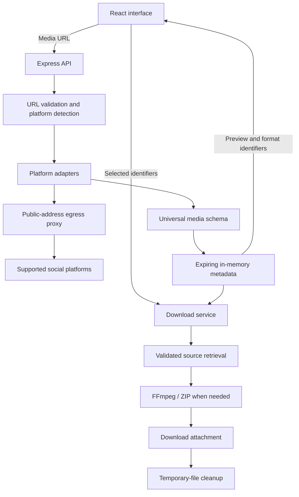

<div align="center">
  

  <h1>BichuxVideo Downloader</h1>
  <h3>Paste. Detect. Download.</h3>
  <p>One link for your videos, audio, and images.<br />
  A self-hosted media downloader with automatic platform detection and a focused interface.</p>

  <p>
    <a href="https://github.com/DzarelDeveloper/BichuxVideo Downloader/stargazers"></a>
    <a href="https://github.com/DzarelDeveloper/BichuxVideo Downloader/forks"></a>
    <a href="https://github.com/DzarelDeveloper/BichuxVideo Downloader/issues"></a>
  </p>

  <p>
    <a href="#quick-start"></a>
    <a href="#features"></a>
    <a href="#architecture"></a>
    <a href="#api-reference"></a>
    <a href="#production-deployment"></a>
  </p>
  <sub>No login · No database · No permanent media storage</sub>
</div>

---

## Overview

BichuxVideo Downloader brings public media links into one workflow: **paste a URL → analyze → preview → download**. Platform detection happens automatically, while a shared media schema keeps image, video, audio, and carousel controls consistent.

Built for local use and self-hosting. The React frontend connects to an Express backend that handles extraction, source validation, FFmpeg processing, and temporary-file cleanup.

<div align="center">
  
  
  
  
  
  
</div>

## Features

| Capability | What you can do |
| --- | --- |
| **Automatic detection** | Paste a supported post link without selecting a platform or downloader type. |
| **Media previews** | View the creator, caption, hashtags, thumbnail, and duration when available. |
| **Video & audio** | Choose an available MP4 resolution or extract MP3 / M4A audio. |
| **Image formats** | Save PNG, JPG, JPEG, or WebP at source dimensions. PNG is the default. |
| **Carousel downloads** | Download one item, select multiple items, or save everything as ZIP. |
| **Mixed media** | Preview images and videos together, with Video / Audio controls for video items. |
| **Responsive interface** | Stay on one page with inline results, loading states, and clear feedback. |
| **Temporary processing** | Remove files after each job and expire analysis metadata in memory. |

### Platforms and accepted links

<p align="center">
  
  
  
  
  
  
</p>

| Platform | Accepted public links | Media scope |
| --- | --- | --- |
| TikTok | Video, photo posts, supported short links | Video, images, slideshows |
| Instagram | Posts, Reels | Images, video, mixed carousels |
| YouTube | Watch, Shorts, individual video links | Video and extracted audio |
| Pinterest | Individual pins, pin.it short links | Images, pin videos, supported multi-item pins |
| Facebook | Video posts, Reels, watch links, photo links, fb.watch/share links | Public videos and individually linked photos; profile/album crawling is excluded |
| X / Twitter | Individual status links on x.com or twitter.com | Images, video, silent GIF-style MP4, mixed attachments |

All six platforms use the same normalized API and download controls. Public access is required. Short links are resolved through the validated HTTP client and checked again before extraction. Board, profile, feed, and search URLs are not download targets.

### Media support

| Media type | Available downloads |
| --- | --- |
| Video, Reels, Shorts | MP4 at available direct-source resolutions, highest first |
| Video audio | MP3 or M4A, processed with FFmpeg |
| Single image | PNG, JPG, JPEG, or WebP at source dimensions |
| Image slideshow / carousel | Individual images, selected items ZIP, all items ZIP |
| Mixed carousel | Images and videos, per-video format selection, ZIP downloads |

Available formats depend on the source. Adaptive MP4 video streams are paired with an available M4A audio stream and remuxed without re-encoding the video. ZIP downloads use each item's selected format. Images default to PNG. JPG and JPEG use the same JPEG encoding with different filename extensions; JPEG is lossy and does not retain transparency. PNG and WebP use lossless encoding, without restoring detail missing from the source.

BichuxVideo Downloader uses legitimately accessible media sources. It does **not** crop, blur, remove, or modify embedded watermarks, and does not guarantee watermark-free output.

## Quick start

These installation commands target **Debian / Ubuntu**. Install Node.js 22.16+ and npm first, then clone the repository:

```bash
git clone https://github.com/DzarelDeveloper/BichuxVideo Downloader.git
cd BichuxVideo Downloader
```

Run the remaining commands from this directory.

### 1. Install system requirements

| Requirement | Purpose |
| --- | --- |
| Node.js 22.16+ and npm | Frontend, API, and yt-dlp JavaScript runtime |
| Python 3.10+ | Runs the media extractors |
| FFmpeg | Audio conversion and video/audio remuxing |
| yt-dlp + EJS components | Video metadata extraction |
| gallery-dl | Image and carousel metadata extraction |

```bash
sudo apt-get install ffmpeg python3-venv

python3 -m venv .venv
source .venv/bin/activate
python -m pip install -r backend/requirements.txt
```

FFmpeg must include AAC, `libmp3lame`, PNG, MJPEG, and `libwebp` encoders. The YouTube adapter explicitly enables the installed Node runtime for JavaScript challenges.

### 2. Install and configure the app

```bash
npm install
cp .env.example .env
```

Default configuration works when the extractor tools and FFmpeg are on `PATH`. Keep the virtual environment active when starting the backend, or set absolute executable paths in `.env`.

### 3. Start development

```bash
npm run dev
```

Open **[localhost:5173](http://localhost:5173)**.

Vite serves the frontend and proxies `/api` requests to Express at `http://127.0.0.1:3001`. Paste a link to a specific public post or video to begin.

### Project commands

| Command | Action |
| --- | --- |
| `npm run dev` | Start Vite and Express with file watching |
| `npm run build` | Build the frontend into `frontend/dist` |
| `npm start` | Start Express and serve the compiled frontend |
| `npm test` | Run backend security and integration tests |
| `npm run format` | Format frontend, backend, and test source files |

## Configuration

Copy [`.env.example`](.env.example) to `.env`. Local environment files are excluded from version control.

| Variable | Default | Description |
| --- | --- | --- |
| `PORT` | `3001` | Express listening port |
| `HOST` | `127.0.0.1` | Express bind address |
| `YTDLP_PATH` | `yt-dlp` | yt-dlp executable name or absolute path |
| `GALLERYDL_PATH` | `gallery-dl` | gallery-dl executable name or absolute path |
| `PYTHON_PATH` | Auto-detected | Python executable containing the yt-dlp module, used by the Instagram, TikTok, and X adapters |
| `FFMPEG_PATH` | `ffmpeg` | FFmpeg executable name or absolute path |
| `MAX_MEDIA_MB` | `200` | Source-byte budget per download and processed-output/archive limit; uses 1,024² bytes per unit |
| `REQUEST_TIMEOUT_MS` | `120000` | Maximum job duration: two minutes |
| `SESSION_TTL_MS` | `900000` | Analysis lifetime: fifteen minutes |
| `MAX_CONCURRENT_JOBS` | `3` | Maximum concurrent API processing jobs |
| `VITE_API_ORIGIN` | Empty | Public backend origin for a separately hosted frontend; set before building |
| `FRONTEND_ORIGINS` | Empty | Comma-separated exact frontend origins allowed by backend CORS |

If you change `PORT`, update the API proxy target in [`frontend/vite.config.js`](frontend/vite.config.js) as well.

## Architecture

The frontend works with one normalized media schema. All platform-specific extraction, source resolution, and processing stay on the backend.



### Project structure

```text
BichuxVideo Downloader/
├── frontend/
│   ├── src/
│   │   ├── main.jsx          # Input, previews, format and carousel controls
│   │   └── styles.css        # Responsive interface and feedback states
│   └── vite.config.js       # React setup and development API proxy
├── backend/
│   ├── python/             # Instagram, TikTok, and X adapters; Python tests
│   ├── src/
│   │   ├── extractors/      # Six platform adapters and shared extraction tools
│   │   ├── app.js           # Routes, middleware and request lifecycle
│   │   ├── server.js        # HTTP server entry point
│   │   ├── security.js      # URL validation, DNS checks and egress proxy
│   │   ├── normalize.js     # Universal schema and public response mapping
│   │   ├── store.js         # Bounded, expiring metadata cache
│   │   ├── download.js      # Source retrieval, FFmpeg and ZIP generation
│   │   ├── process.js       # Shell-free subprocess execution and limits
│   │   ├── temp.js          # Temporary workspace creation and cleanup
│   │   └── config.js        # Environment settings and application errors
│   └── test/core.test.js    # Security, API and processing tests
├── Dockerfile              # Backend container for Render or other hosts
├── netlify.toml            # Frontend build and routing configuration
├── .env.example
├── .gitignore
└── package.json             # npm workspaces and shared commands
```

<details>
<summary><strong>Platform adapter implementation notes</strong></summary>

TikTok video links use a Python yt-dlp adapter that preserves anonymous session cookies per media source, with gallery-dl as fallback. Image posts try gallery-dl first. Session cookies remain in expiring server-side metadata and are stripped on cross-origin redirects; no user cookies or login are imported. Instagram extends yt-dlp’s metadata mapping to retain original images and mixed carousels before video-only result processing, with gallery-dl as a fallback. Its Python adapter uses the same public-address proxy and does not add login or cookies. YouTube uses yt-dlp directly. The Instagram adapter overrides an internal yt-dlp mapping method; run its regression tests after extractor updates. Pinterest uses gallery-dl with direct-MP4 fallback selection, then yt-dlp. Facebook routes photo links to gallery-dl and videos to yt-dlp. X uses a Python adapter to retain photo and video attachments from yt-dlp metadata, with its public syndication endpoint as a fallback for empty results. These adapters do not add login or import user cookies. To extend platform support, add an adapter, register it in `extractors/index.js`, update URL validation, and test its normalized output.

</details>

## API reference

All request bodies use JSON. Download responses are binary attachments; errors use a JSON `error` field.

| Method | Endpoint | Purpose |
| --- | --- | --- |
| `POST` | `/api/v1/media/analyze` | Validate a link and return normalized media |
| `POST` | `/api/v1/media/download` | Download selected formats or a ZIP |
| `GET` | `/api/v1/media/:id/preview/:item` | Proxy a validated thumbnail |
| `GET` | `/api/v1/health` | Check API liveness |

<details>
<summary><strong>Request examples, response schema, and error codes</strong></summary>

### Analyze a link

```bash
curl http://127.0.0.1:3001/api/v1/media/analyze \
  -H 'Content-Type: application/json' \
  -d '{"url":"https://www.youtube.com/watch?v=VIDEO_ID"}'
```

Example response structure; identifiers and metadata are illustrative:

```json
{
  "id": "opaque-session-id",
  "platform": "YouTube",
  "sourceUrl": "https://www.youtube.com/watch?v=VIDEO_ID",
  "title": "Post title",
  "creator": "Creator",
  "type": "video",
  "expiresAt": 1900000000000,
  "items": [
    {
      "id": "opaque-item-id",
      "type": "video",
      "duration": 42,
      "previewUrl": "/api/v1/media/opaque-session-id/preview/opaque-item-id",
      "formats": [
        {
          "id": "opaque-format-id",
          "kind": "video",
          "extension": "mp4",
          "label": "1080p"
        }
      ]
    }
  ]
}
```

Top-level `type` is `video`, `image`, `slideshow`, or `mixed`. Duration is in seconds; `expiresAt` is a Unix timestamp in milliseconds. Metadata such as creator, duration, and preview can be null when unavailable.

Upstream media URLs remain on the server. Analysis identifiers expire after fifteen minutes by default and are lost on server restart. Analyze the original URL again to obtain fresh identifiers.

### Download a selection

Use the identifiers returned by analysis:

```bash
curl --fail-with-body http://127.0.0.1:3001/api/v1/media/download \
  -H 'Content-Type: application/json' \
  -d '{
    "mediaId": "opaque-session-id",
    "selections": [
      {"itemId": "opaque-item-id", "formatId": "opaque-format-id"}
    ],
    "archive": false
  }' \
  --output media.mp4
```

One selection returns its chosen format. Multiple selections, or `"archive": true`, return ZIP; use a `.zip` output filename. Each item may appear only once in a request. The API never accepts arbitrary source URLs or FFmpeg arguments from the client.

### Errors

```json
{
  "error": "This preview expired. Analyze the link again."
}
```

| Status | Typical cause |
| --- | --- |
| `400` | Invalid URL, unsupported domain, or invalid selection |
| `408` | Job timeout or cancellation |
| `410` | Expired or missing analysis |
| `413` | Request, item count, or media size limit exceeded |
| `422` | Restricted, unavailable, or unsupported media; extraction/processing failure |
| `429` | Rate limit exceeded |
| `502` | Upstream media source unavailable |
| `503` | Missing executable or all processing slots busy |

The health endpoint reports server liveness; it does not verify extractor installation or platform availability.

</details>

## Security and storage

### Network controls

- Accepts HTTP/HTTPS links on supported domain boundaries and specific-post paths.
- Rejects URL credentials, nonstandard ports, localhost, private addresses, and internal network destinations, including IPv4-mapped IPv6.
- Resolves and pins validated public addresses for outbound connections to prevent DNS rebinding.
- Revalidates thumbnail/media redirects, with a maximum of five redirects.
- Routes extractor traffic through a loopback HTTP/CONNECT proxy that checks each destination. HTTPS certificate verification remains enabled.
- Executes subprocesses without a shell. FFmpeg reads local files with network protocols disabled.

### Default resource limits

| Resource | Limit |
| --- | --- |
| API requests | 40 per minute per IP |
| Concurrent analysis/download jobs | 3 |
| Concurrent previews | 4, with a separate bounded queue |
| Job duration | 120 seconds |
| JSON request body | 8 KB |
| Media items per post | 30 |
| Cached analyses | 100 |
| Analysis lifetime | 15 minutes |
| Cumulative source bytes per download | 200 MiB |
| Processed output / ZIP size | 200 MiB |
| Thumbnail size | 8 MiB |

Downloads use temporary files, including original media, so size limits can be enforced before responding. Files are removed after completion, errors, or client disconnects. Only metadata is cached in memory.

A forced process kill or power loss can leave `bichuxvideo-*` folders in the system temporary directory. Configure the host's temporary-file janitor to remove orphaned folders. The browser buffers completed downloads as a Blob, so lower the media limit for memory-constrained deployments.

## Production deployment

Build the frontend, then let Express serve both the app and API:

```bash
npm run build
npm start
```

Use a **Node-capable VM or container** with Python, the extractors, and FFmpeg installed. Static hosting and Cloudflare Workers cannot execute this backend.

- Keep the Python virtual environment active or configure absolute tool paths.
- Set `HOST=0.0.0.0` when the container or reverse-proxy topology requires it.
- Terminate HTTPS at the reverse proxy and allow enough time for processing requests.
- Configure Express `trust proxy` for your exact topology before relying on per-client rate limits behind a proxy; forwarded client-IP headers are not trusted by default.
- Run as an unprivileged user with a bounded temporary volume. An outbound firewall adds defense in depth.

The MVP is designed for modest, single-instance use. It has no persistent job queue, resumable downloads, or shared session store across instances.

## Deploy the backend on Render

The root `Dockerfile` installs Node.js, Python, FFmpeg, and pinned extractor versions. It runs the API as a non-root user, listens on `0.0.0.0`, and respects Render's `PORT`. No database or persistent disk is required.

1. In [Render](https://dashboard.render.com/), choose **New → Web Service** and connect `DzarelDeveloper/BichuxVideo Downloader`.
2. Choose branch `main`, language **Docker**, and instance type **Free**. Leave **Root Directory** empty and use `./Dockerfile` as the Dockerfile path. Leave the Docker Command override empty.
3. Add `FRONTEND_ORIGINS=https://your-site.netlify.app` in **Environment**, replacing the example with your exact frontend origin (no trailing slash).
4. Set the health check path to `/api/v1/health`, then deploy.
5. Open `https://your-service.onrender.com/api/v1/health`. A running API returns `{"status":"ok"}`. This checks liveness, not platform extraction.
6. Configure Netlify as described below, then test analysis and a small download from the deployed frontend.

The container defaults to one processing job and a 50 MiB media limit to reduce memory pressure on small instances. Override `MAX_CONCURRENT_JOBS` and `MAX_MEDIA_MB` only when your hosting resources allow it. Update `backend/requirements.txt` and run the Python regression tests when upgrading extractors.

[Render Free](https://render.com/docs/free) sleeps after 15 idle minutes and can take about a minute to wake. Bandwidth and outbound traffic limits apply, making this suitable for light testing rather than a busy public downloader. Restarting clears analysis sessions; analyze the link again if a download handle expires. Social platforms may also restrict datacenter IPs, so successful local extraction does not guarantee hosted extraction.

## Deploy the frontend on Netlify

Connect `DzarelDeveloper/BichuxVideo Downloader` to Netlify. The included `netlify.toml` uses the repository root, `npm run build`, and `frontend/dist`.

1. Deploy the backend on a Node-capable server with Python, yt-dlp, gallery-dl, and FFmpeg. Netlify hosts the frontend only.
2. In Netlify, set `VITE_API_ORIGIN` to the backend HTTPS origin, such as `https://api.example.com` (no `/api` suffix), then deploy. This is public build-time configuration, never a secret.
3. On the backend, set `FRONTEND_ORIGINS` to the exact Netlify site origin, such as `https://your-site.netlify.app`. Separate multiple allowed origins with commas.
4. Set backend `HOST=0.0.0.0` if required by your hosting provider and keep executable paths configured.

Requests and thumbnails go directly to the backend. This avoids Netlify proxy timeouts for long-running media jobs. Without a deployed backend and these environment values, the Netlify UI will load but analysis/downloads will not work. Local development continues to use the Vite API proxy when `VITE_API_ORIGIN` is empty.

## Testing

With FFmpeg installed and local socket access available:

```bash
npm test
python backend/python/test_instagram.py
python backend/python/test_twitter.py
npm run build
```

The automated suite covers domain and IP boundaries, blocked proxy destinations, mixed-carousel normalization, adaptive audio/video pairing, temporary-file cleanup, real FFmpeg conversion, ZIP output, and API input validation.

Automated tests use synthetic metadata and locally generated media. They do not guarantee ongoing access to social platforms; verify authorized public posts in your own hosting environment.

## Troubleshooting

| Symptom | What to check |
| --- | --- |
| “Required tool … is not installed” | Activate `.venv`, check the executable on `PATH`, or set its absolute path in `.env`. |
| Development startup fails while watching `.env` | Run `cp .env.example .env` before starting development. |
| Frontend loads but API requests fail | Confirm Express is running and the Vite proxy matches `PORT`. |
| A public post cannot be analyzed | Verify it opens publicly; platform bot checks, region restrictions, or extractor changes may prevent access. |
| No supported direct source is available | Try another post. Manifest-only sources are outside this MVP's processing support. |
| Preview expired or disappeared after restart | Analyze the original link again. Metadata exists only in memory. |
| Download exceeds the size limit or times out | Choose a smaller format or fewer carousel items; adjust server limits only if resources allow. |
| Audio conversion fails | Verify the FFmpeg installation includes AAC and `libmp3lame`. |

To update the extractors, activate the project's virtual environment and run:

```bash
python -m pip install -U 'yt-dlp[default]' gallery-dl
```

## Known limitations

- Platform access depends on current extractors, the server's region/IP, and source availability. Even public posts can trigger login or bot checks.
- Private, login-gated, age-restricted, and DRM-protected content is not supported. There is no cookie import or authentication bypass.
- Only direct HTTP(S) media sources are processed. Manifest-only HLS/DASH sources are excluded; ongoing live streams, profile feeds, and playlists are outside the supported workflow.
- Titles, creators, durations, resolutions, or thumbnails may be missing from source metadata.
- Carousel support depends on source availability. If normalization finds an unsupported item, the post is rejected rather than silently dropping that item. Video-only multi-item posts also use the `mixed` collection type.
- Platform and media-type coverage varies by post. Test media you are authorized to download before making the app publicly available.

## Responsible use

Download only media you own or have permission to download. Respect creators' rights and the source platform's terms. BichuxVideo Downloader does not grant rights to third-party content or bypass platform access restrictions.

## Built with

[React](https://react.dev/) · [Vite](https://vite.dev/) · [Express](https://expressjs.com/) · [FFmpeg](https://ffmpeg.org/) · [yt-dlp](https://github.com/yt-dlp/yt-dlp) · [gallery-dl](https://github.com/mikf/gallery-dl)

## Contributing

Bug reports, documentation improvements, and platform fixes are welcome. Open an [issue](https://github.com/DzarelDeveloper/BichuxVideo Downloader/issues) with reproduction steps and relevant error messages, or submit a pull request describing the change and how you tested it. Remove credentials and private media links from reports.

For extractor changes, run the backend and Python tests before submitting. Keep platform-specific logic in the backend and preserve the universal media schema.

---

<div align="center">
  <h3>Built by Dzarel Alghifari</h3>
  <p>Maintained as <a href="https://github.com/DzarelDeveloper"><strong>@DzarelDeveloper</strong></a>.</p>
  <p>
    <a href="https://github.com/DzarelDeveloper"></a>
    <a href="https://github.com/DzarelDeveloper/BichuxVideo Downloader/issues/new"></a>
  </p>
  <sub>BichuxVideo Downloader · Paste. Detect. Download.</sub>
</div>
